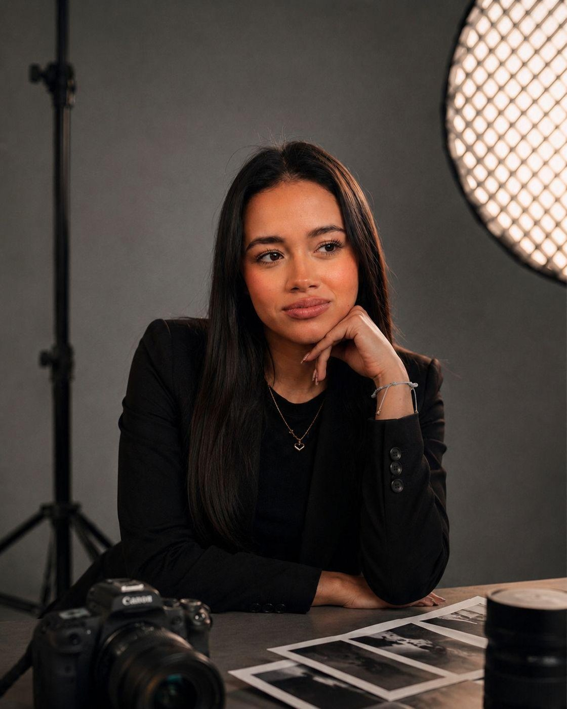

# Paula Arias · Portafolio

**Creadora digital** · Estudiante de Creación Digital, Universidad El Bosque.
Mezclo fotografía, video, 3D, ilustración, animación y diseño UX/UI para crear experiencias visuales que cuentan historias.

### 👉 [Ver el portafolio](https://pau0701.github.io/PORTAFOLIO/)

## Proyectos

| Proyecto | Disciplina |
|---|---|
| **Paradoja Rosa** | Composición 3D en Blender: modelado, iluminación y materiales, con ilustraciones propias en Illustrator |
| **Tous Essentials** | Fotografía de producto en estudio |
| **Tiendy** | App móvil · diseño UX/UI: más de 40 pantallas en 9 flujos para tenderos de barrio |
| **Parchese** | Microcorto: dirección, actuación y producción audiovisual |

Cada sección tiene su propio enlace:
[Sobre mí](https://pau0701.github.io/PORTAFOLIO/#sobre-mi) ·
[Paradoja Rosa](https://pau0701.github.io/PORTAFOLIO/#paradoja-rosa) ·
[TOUS](https://pau0701.github.io/PORTAFOLIO/#tous) ·
[Tiendy](https://pau0701.github.io/PORTAFOLIO/#tiendy) ·
[Parchese](https://pau0701.github.io/PORTAFOLIO/#parchese) ·
[Contacto](https://pau0701.github.io/PORTAFOLIO/#contacto)

## Contacto

**Paula Andrea Arias Mora** · [parias@unbosque.edu.co](mailto:parias@unbosque.edu.co)

---

© Paula Andrea Arias Mora. Todas las imágenes, renders, video y diseños son obra de la autora; no se permite su reutilización sin autorización.
